# AI Tester Blueprint 5x

A hands-on learning repository for building AI-assisted QA workflows with Command Code. It walks from authoring reusable skills, through LLM fundamentals, prompt engineering, and QA prompt frameworks, to vibe-coded and n8n-hosted AI agents — and ships ready-made artifacts (test plans, test cases, bug reports) generated by those skills and prompts, plus reusable context packs, a 17-task daily QA prompt template library with HTML usage guides, a live-verified Adactin hotel-app context pack, three deployed vibe-coded QA agents (test plan → test strategy → test cases), and four importable n8n QA agents.

## Contents

- [Roadmap](#roadmap) · [Repository Structure](#repository-structure) · [What It Looks Like](#what-it-looks-like)
- [Skills](#skills) · [Generated Artifacts](#generated-artifacts)
- [Chapter 01 — LLM Basics](#chapter-01--llm-basics) · [Chapter 02 — Prompt Engineering](#chapter-02--prompt-engineering) · [Chapter 03 — Prompt Engineering for QA](#chapter-03--prompt-engineering-for-qa)
- [Chapter 04 — AI Agents Basics](#chapter-04--ai-agents-basics) · [Chapter 05 — AI Agents with n8n](#chapter-05--ai-agents-with-n8n)
- [Standalone Playwright Login Test](#standalone-playwright-login-test) · [Learning Journal](#learning-journal) · [Core Principles](#core-principles)
- [Configuration](#configuration) · [Usage](#usage)

## Roadmap

The repository is a staged path: **author skills → understand the models → engineer the prompts → apply prompt frameworks to QA deliverables → build AI agents**.

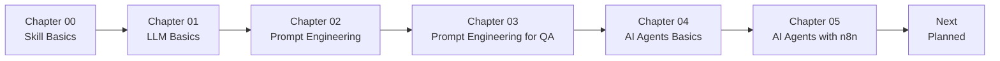

| Stage | Chapter | Focus | Status |
|-------|---------|-------|--------|
| 1 | Chapter 00 — Skill Basics | Author and run reusable Command Code skills that generate test plans / test cases | ✅ Done |
| 2 | Chapter 01 — LLM Basics | LLM fundamentals self-study guide (lessons, labs, glossary) | ✅ Done |
| 3 | Chapter 02 — Prompt Engineering | RICE_POT prompt framework → generated Selenium / Playwright frameworks | ✅ Done |
| 4 | Chapter 03 — Prompt Engineering for QA | STAR / CLEAR / CRISP frameworks → test plans, test cases, bug reports (DOCX), fill-in and live-verified context packs, plus a 17-task daily QA prompt-template library with HTML usage guides | ✅ Done |
| 5 | Chapter 04 — AI Agents Basics | Vibe-coded QA agents: design → plan → implementation. Three agents — Jira → test plan (React + Express), Jira → test strategy and Jira → test cases (Express + vanilla JS) — all deployed to Vercel | ✅ Done |
| 6 | Chapter 05 — AI Agents with n8n | Importable n8n chat agents: QA-only assistant, Jira → test plan, Jira → test strategy, Jira → test cases | ✅ Done |
| 7 | Next | API-response-validator skill, CSV/XLSX export for generated artifacts, CI wiring | 🔜 Planned |

## Repository Structure

```
AITesterBlueprint5x/
├── Chapter_00_SKILL_Basics/            # Authoring and using Command Code skills
│   ├── 00_Basic_Skills/                # PRD-driven skills
│   │   ├── api-response-validator-skill/   # Placeholder (SKILL.md pending)
│   │   ├── testcase-creator-skill/         # Generates test cases from a PRD
│   │   └── testplan-creator-skill/         # Generates a test plan from a PRD
│   ├── 01_Advanced_Skills/
│   │   └── testplan-creator-skill_a/   # Jira-driven test plan (fetch → gap analysis → review gate)
│   │       ├── references/             # Gap-analysis checklist + plan template
│   │       ├── scripts/                # fetch-jira.{sh,py} — pull a ticket over the Jira REST API
│   │       ├── misc/                   # Company details + logo (mycompanydetails.md, company.png)
│   │       └── assets/                 # Skill assets (currently empty)
│   ├── output/                         # Generated deliverables (HTML, PDF, XLSX, CSV)
│   │   ├── KAN-4_Passkey_SSO_Login_Test_Plan.{html,pdf}
│   │   ├── VWO_Login_Dashboard_Test_Plan.{html,pdf}
│   │   └── VWO_Login_Dashboard_Test_Cases.{html,xlsx,csv}
│   ├── resources/                      # Source / reference material (e.g. VWO-49.doc)
│   ├── .env                            # Jira credentials for the advanced skill (see Configuration)
│   └── MyNotes.md                      # Working notes and context for generated plans
├── Chapter_01_LLM_Basics/              # LLM fundamentals self-study guide
│   └── LLM_Fundamentals.html           # Interactive guide: lessons, labs, glossary
├── Chapter_02_Prompt_Engineering/      # Prompt engineering with the RICE_POT framework
│   ├── RICE_POT/
│   │   ├── Template_RICE_POT/          # Blank RICE-POT prompt template
│   │   ├── REALPROMPT_RICE_POT.md      # Filled prompt → Selenium + Java (Salesforce login)
│   │   ├── REALPROMPT_RICE_POT_PW.md   # Filled prompt → Playwright + TypeScript (VWO login)
│   │   ├── SeleniumFramework/          # Generated Maven / TestNG framework + Allure report
│   │   └── PlaywrightFramework/        # Generated Playwright / TypeScript framework + Allure report
│   ├── output/                         # Generated test cases + test-case quality report (HTML)
│   ├── Product Requirements Document_ VWO Login Dashboard.pdf
│   ├── anti-hallucination-rules.md     # Guardrails reused across prompts
│   └── MyNotes.md                      # Working notes for the chapter
├── Chapter_03_Prompt_Engineering_QA/   # QA prompt frameworks: STAR / CLEAR / CRISP (+ RICE-POT)
│   ├── STAR.md                         # STAR prompt → VWO login functional test plan
│   ├── STAR_HotelApp.md                # STAR prompt → Adactin Hotel App test plan
│   ├── CLEAR.md                        # CLEAR prompt → VWO login functional test cases
│   ├── CRISP.md                        # CRISP prompt → VWO login bug report
│   ├── Template.md                     # 10-section test-plan skeleton used by the prompts
│   ├── Templates/                      # Reusable framework definitions (STAR, CLEAR, CRISP)
│   ├── 00_context-vwo/                 # Fill-in context pack: project, feature, testing, constraints
│   ├── 00_context-hotelapp/            # Live-verified Adactin context pack (Build 2)
│   │   ├── 01_context_project.md … 04_context_constraints.md
│   │   ├── 05_context_application_modules.md   # Per-module, field-level reference
│   │   ├── .env                        # Adactin test credentials (gitignored)
│   │   └── MyNotes.md                  # Run log for the pack
│   ├── 01_reuse-templates-testing/     # 6 test-case prompt templates (basic → regression)
│   ├── 02_reuse-templates-bugs/        # 6 bug-report prompt templates + anti-hallucination reminder
│   ├── 03_reuse-templates-api/         # 6 API-testing prompt templates
│   ├── Task14Nov2026_QA_DailyTask/     # 17 daily QA prompt templates + HTML usage guides
│   │   ├── 01-requirement-analysis-RICEPOT.md … 17-test-coverage-CLEAR.md
│   │   ├── *-usage-guide.html          # One "how to use this template" guide per template
│   │   ├── INDEX.md                    # Task → framework → file map + shared conventions
│   │   └── MyNotes_Task14Nov2026.md    # Working notes for the library
│   ├── output/                         # Generated DOCX/PDF/HTML deliverables
│   └── MyNotes.md                      # Prompt run log (which prompt → which output)
├── Chapter_04_AI_Agents_Basics/        # Vibe-coded QA AI agents (design → plan → implementation)
│   └── VIBE_CODING/
│       ├── .env                        # Shared Jira + Groq credentials (gitignored)
│       ├── 01_Intelligent_Test_Planning_AIAgent/   # Jira ticket → test plan
│       │   ├── 00_design/              # Screen design plan (screen_design_plan.png)
│       │   ├── 01_plan/                # RICE-POT framework + test-plan template
│       │   ├── 02_Implementation/      # Build prompt, React + Vite + Express app, Vercel config, README
│       │   ├── Jira-Test-Plan-Generator-*.png   # App screenshots
│       │   ├── test-plan.md            # Sample generated plan (KAN-5)
│       │   └── MyNotes.md              # Build prompt log for the agent
│       ├── 02_Test_Strategy_Builder_AIAgent/       # Jira ticket → test strategy
│       │   ├── 00_design/              # screen_design_strategy.png
│       │   ├── 01_plan/                # RICE-POT framework + 14-section strategy template
│       │   ├── 02_implementation/src/  # Express + vanilla JS app, Vercel config, README
│       │   ├── AI-Test-Strategy-Builder-*.png   # App screenshots
│       │   ├── test-strategy.md        # Sample generated strategy (KAN-5)
│       │   └── MyNotes.md
│       └── 03_Test_Case_Creation_AIAgent/          # Jira ticket → test cases
│           ├── 00_design/              # screen_design_test_cases.png
│           ├── 01_plan/                # RICE-POT framework + 8-section test-case template
│           ├── 02_implementation/src/  # Express + vanilla JS app, Vercel config, README
│           ├── AI-Test-Case-Generator-*.png     # App screenshots
│           ├── test-cases.md           # Sample generated cases (KAN-4)
│           └── MyNotes.md
├── Chapter_05_AIAgents_n8n/            # n8n AI-agent workflows (importable JSON)
│   ├── 01_QA_Assistant.json            # Chat trigger → AI agent → Groq, QA-only answers
│   ├── 02_Jira_TestPlan.json           # Chat trigger → AI agent + Jira tool + Groq, RICE-POT plans
│   ├── 03_AI-Powered_Jira_Test_Strategy_Agent.json  # Jira tool → 14-section test strategy
│   ├── 04_Test_Case_Creation_AI_Agent.json          # Jira tool → execution-ready test cases
│   ├── n8n_Basics.png                  # One-page n8n primer + QA alert example
│   └── MyNotes.md                      # System prompts and published chat URLs
├── Playwright_Simple_Login/            # Standalone Playwright + TypeScript login test
│   ├── tests/login.spec.ts             # Valid + invalid login against the-internet demo app
│   ├── playwright.config.ts            # Chromium, list + HTML reporter, trace on failure
│   ├── package.json / tsconfig.json
│   └── .gitignore                      # Ignores node_modules, reports, test results
└── learnings/                          # Dated learning journal (see AGENTS.md)
```

## What It Looks Like

Three vibe-coded agents from Chapter 04, all live on Vercel. Each takes a Jira issue key and returns a DRAFT document that a human signs off on.

| Agent | Input → output | Live |
|-------|----------------|------|
| **Jira Test Plan Generator** | `KAN-5` → 8-section test plan | [ai5x-intelligenttestplan.vercel.app](https://ai5x-intelligenttestplan.vercel.app) |
| **AI Test Strategy Builder** | `KAN-5` → 14-section test strategy | [ai5x-teststrategybuilder.vercel.app](https://ai5x-teststrategybuilder.vercel.app) |
| **AI Test Case Generator** | `KAN-4` → 8-section test-case document | [ai5x-testcasecreator.vercel.app](https://ai5x-testcasecreator.vercel.app) |

<p align="center">
  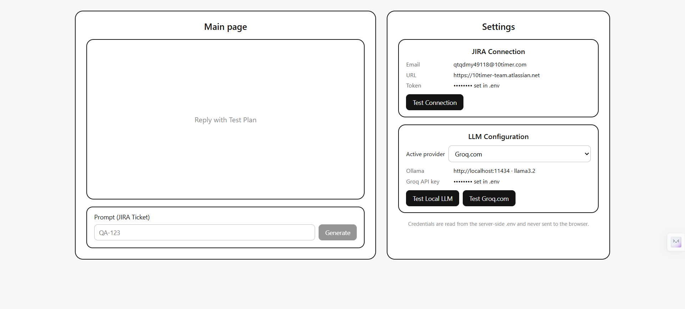
  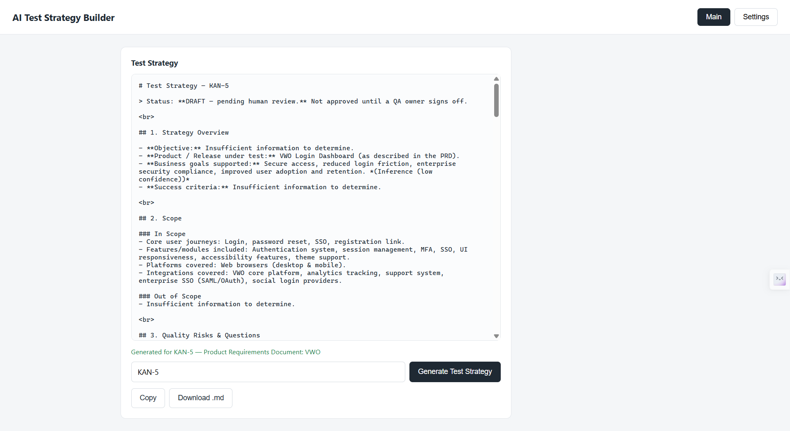
</p>
<p align="center">
  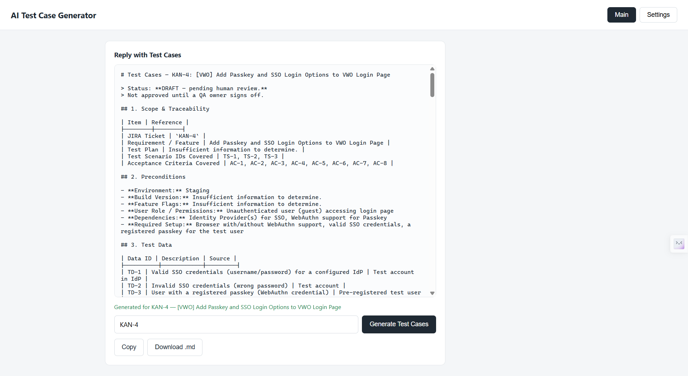
</p>

## Skills

Skills are reusable instruction modules that Command Code loads on demand. Each one lives in its own folder with a `SKILL.md` file that declares frontmatter (`name`, `description`, `version`, `author`, `license`, `tags`) followed by the instructions the agent follows.

### Basic skills — `Chapter_00_SKILL_Basics/00_Basic_Skills/`

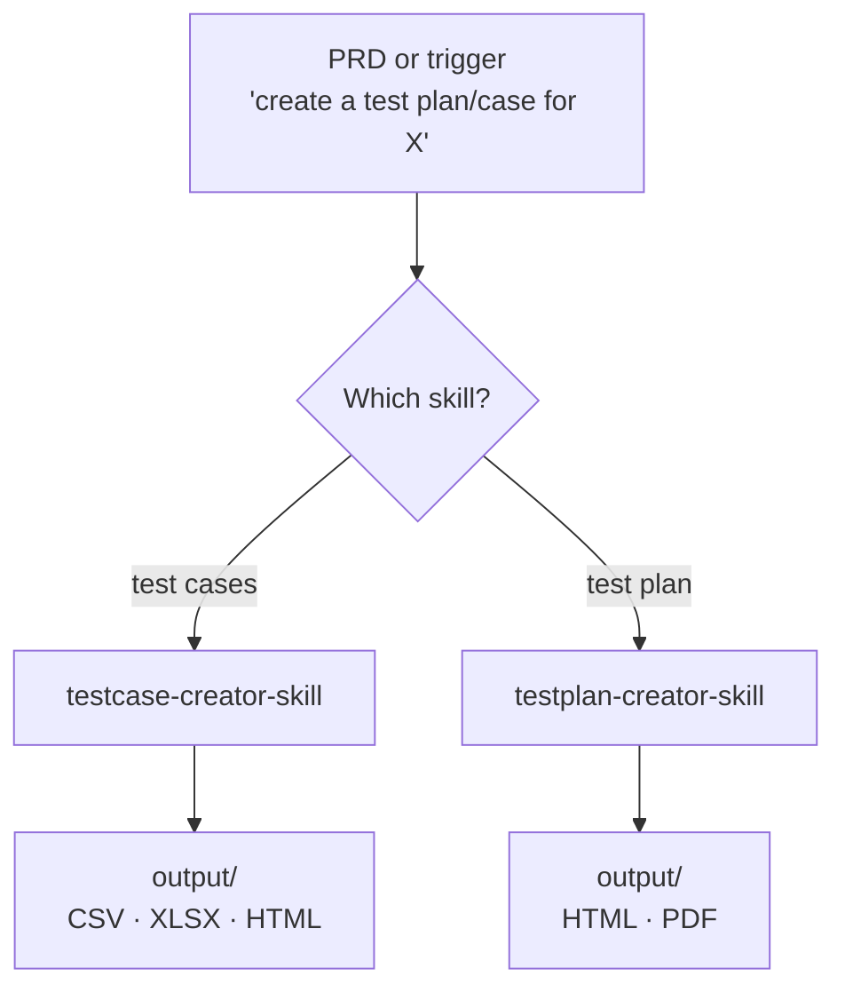

#### `testcase-creator-skill`

Creates test cases from a PRD or a direct trigger such as *"create a test case for X"*, using the VWO.com template.

Output columns: `Scenario_TID`, `TestCase Description`, `PreCondition`, `TestSteps`, `Expected Result`, `Actual Result`, `Steps to Execute`, `Expected Result`, `Actual Result`, `Status`, `Executed QA Name`, `Misc (Comments)`, `Priority`, `Is_Automated`.

Deliverables: CSV, XLSX, and HTML.

#### `testplan-creator-skill`

Creates a full test plan from a PRD using the VWO.com template, covering objective, scope, inclusions, environments, defect reporting, strategy, schedule, deliverables, entry/exit criteria, tools, risks, and approvals.

Deliverables: HTML and PDF.

#### `api-response-validator-skill`

Reserved for validating API responses. The `SKILL.md` is currently a placeholder.

### Advanced skill — `Chapter_00_SKILL_Basics/01_Advanced_Skills/testplan-creator-skill_a/`

#### `advance-testplan-creator`

Turns a **JIRA ticket** into a review-ready test plan. It is a stricter, Jira-driven evolution of the basic test-plan skill and follows a fixed workflow:

1. **Fetch the ticket** — pulls the issue over the Jira REST API (`scripts/fetch-jira.sh`) and captures summary, description, acceptance criteria, components, links, and fix version.
2. **Analyse against a checklist** — scores the ticket against `references/requirement-checklist.md`, marking each item ✅ present / ⚠️ ambiguous / ❌ missing.
3. **Surface the gaps** — produces a *"Gaps & Questions for the Author"* section (the highest-value output).
4. **Draft the plan** — fills `references/test-plan-template.md`, driving scenarios from the acceptance criteria and gaps; tags each scenario P0/P1/P2; adds company info and logo from `misc/`.
5. **Stop for human review** — ends with a mandatory **Human Review Gate** and never marks the plan as final.

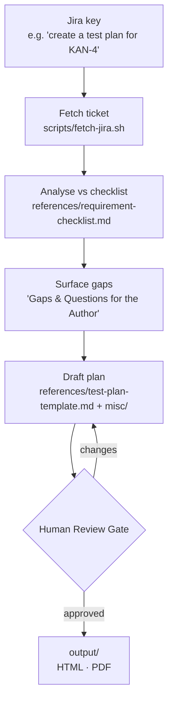

Deliverables: HTML and PDF.

## Generated Artifacts

Example deliverables produced by the skills are stored in `Chapter_00_SKILL_Basics/output/`:

- **KAN-4** — VWO Passkey & SSO login test plan (HTML + PDF), generated by the advanced skill.
- **VWO Login Dashboard** — test plan (HTML + PDF) and test cases (HTML, XLSX, CSV).

The PDF is produced from the finished HTML so the two match 1:1.

## Chapter 01 — LLM Basics

`Chapter_01_LLM_Basics/LLM_Fundamentals.html` is a self-contained, interactive study guide covering LLM fundamentals from scratch, aimed at QA testers new to AI:

- **13 short lessons** with hand-drawn diagrams — tokens, embeddings, context windows, sampling, prompting, and more.
- **9 hands-on labs** — tokenizers, probability bars, context budgeting, and other runnable demos that work entirely in the browser.
- **Quick checks** — collapsible checkpoint questions to test understanding.
- **Glossary** — 97 AI terms, searchable and filterable.
- **Reference** — print-friendly layout and a curated source list.

Open the file directly in any browser — no build step or server required.

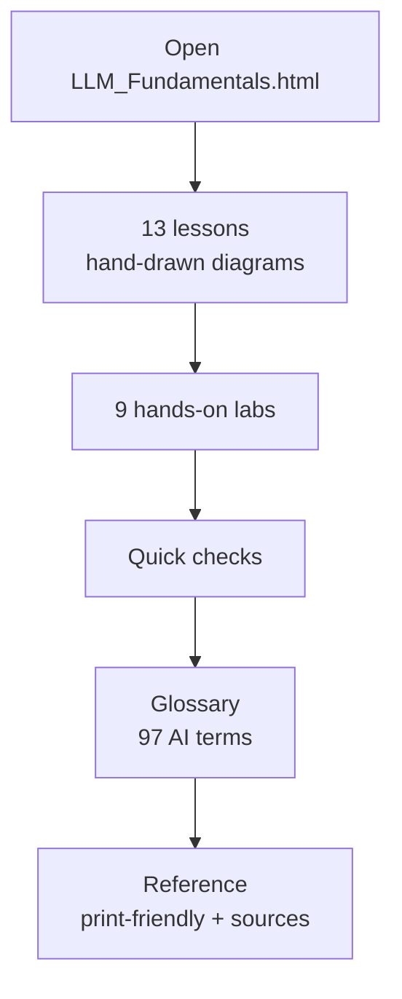

## Chapter 02 — Prompt Engineering

`Chapter_02_Prompt_Engineering/RICE_POT/` applies the **RICE_POT** prompt framework (Role · Instructions · Context · Example · Parameters · Output · Tone) to generate automation frameworks:

- **`Template_RICE_POT/Template.RICEPPOT.md`** — a blank RICE-POT prompt template.
- **`REALPROMPT_RICE_POT.md`** — a filled prompt that generates a **Selenium + Java** (Maven/TestNG) framework for the Salesforce login page.
- **`REALPROMPT_RICE_POT_PW.md`** — a filled prompt that generates a **Playwright + TypeScript** framework for the VWO login page.
- **`SeleniumFramework/`** — the generated Maven project (`pom.xml`, `testng.xml`, Page Object + valid/invalid tests) with an Allure report.
- **`PlaywrightFramework/`** — the generated Playwright/TypeScript project (`pages/`, `tests/`, `fixtures/`, `utils/`, `playwright.config.ts`) with Playwright + Allure reports.

The chapter also carries the source material those prompts work from — the VWO login PRD (`Product Requirements Document_ VWO Login Dashboard.pdf`), a shared `anti-hallucination-rules.md`, and `output/` holding the generated test cases plus the `VWO_Test_Case_Quality_Report_GAP-01.html` quality report.

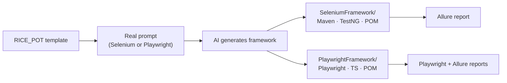

## Chapter 03 — Prompt Engineering for QA

`Chapter_03_Prompt_Engineering_QA/` takes the prompt-engineering idea into day-to-day QA deliverables. Instead of one big framework, it uses three compact frameworks — **STAR**, **CLEAR**, and **CRISP** — each tuned to a different artifact, and ships the runnable prompts plus the documents they produced.

| Framework | Shape | Used for | Prompt file |
|-----------|-------|----------|-------------|
| **STAR** | Situation · Task · Action · Result | Functional **test plans** | `STAR.md` (VWO), `STAR_HotelApp.md` (Adactin) |
| **CLEAR** | Context · Limits · Examples · Action · Review | **Test cases** with hard limits and a self-review pass | `CLEAR.md` |
| **CRISP** | Context · Role · Instructions · Style · Parameters | Reproducible **bug reports** | `CRISP.md` |

Test plans follow the fixed 10-section skeleton in `Template.md` (objective, scope, inclusions, environments, defect reporting, strategy, schedule, deliverables, entry/exit criteria, tools, risks, approvals).

<p align="center">
  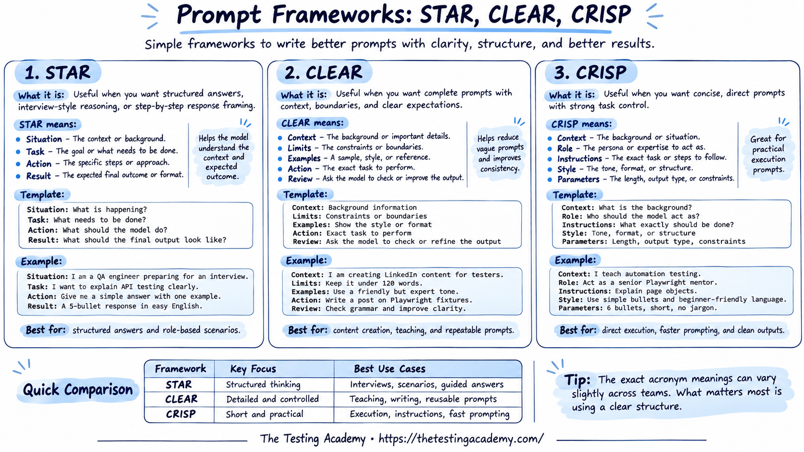
</p>
<p align="center"><em><code>Prompt_framework_STAR-CLEAR-CRISP.png</code> — the three frameworks side by side: what each letter means, the template, a worked example and the best use case.</em></p>

<p align="center">
  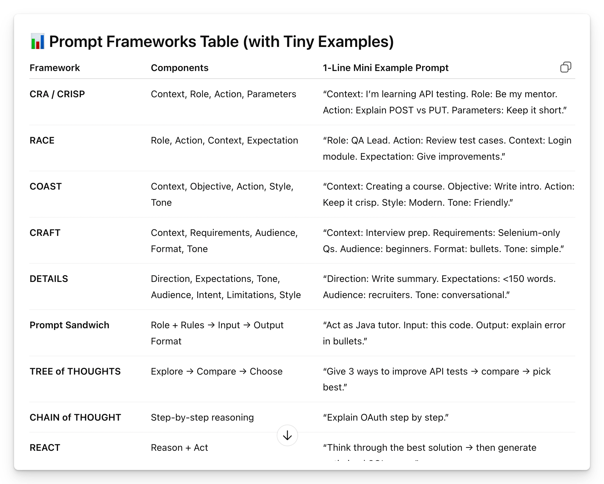
</p>
<p align="center"><em><code>Other_Prompt_Frameworks.png</code> — the wider family beyond STAR/CLEAR/CRISP, one-line example each, for picking the right shape per task.</em></p>

The daily-task library described below also pulls in **RICE-POT** from Chapter 02, for the five tasks where traceability and anti-hallucination matter more than terseness: requirement analysis, test case design, RTM, gap analysis, and automation code generation.

### What's inside

- **`Templates/`** — the three framework definitions (`Template_STAR.md`, `Template_CLEAR.md`, `Template_CRISP.md`) with meanings and examples.
- **`00_context-vwo/`** — a fill-in context pack (`01_context_project` → `04_context_constraints`) so prompts get complete, reusable background instead of ad-hoc description.
- **`00_context-hotelapp/`** — the same four context files filled in for the Adactin Hotel Reservation System (Build 2) and verified live, plus `05_context_application_modules.md` (per-module page titles, form actions, field IDs, messages) and a `MyNotes.md` run log. Unverified areas stay marked `[NEEDS CLARIFICATION]`.
- **`01_reuse-templates-testing/`** — six test-case prompt templates: basic generation, comprehensive PRD coverage, API cases, negative cases, security cases, regression suite.
- **`02_reuse-templates-bugs/`** — six bug-report templates: basic report, classification, analysis, report review, notes-to-bug, plus an anti-hallucination reminder.
- **`03_reuse-templates-api/`** — six API-testing templates: test suite, validation, authentication, contract testing, performance, error handling.
- **`Task14Nov2026_QA_DailyTask/`** — 17 task-per-file prompt templates plus a companion HTML usage guide for each (detailed below).
- **`output/`** — the generated documents, all editable DOCX (plus the Adactin prompt shown as HTML/PDF).

<p align="center">
  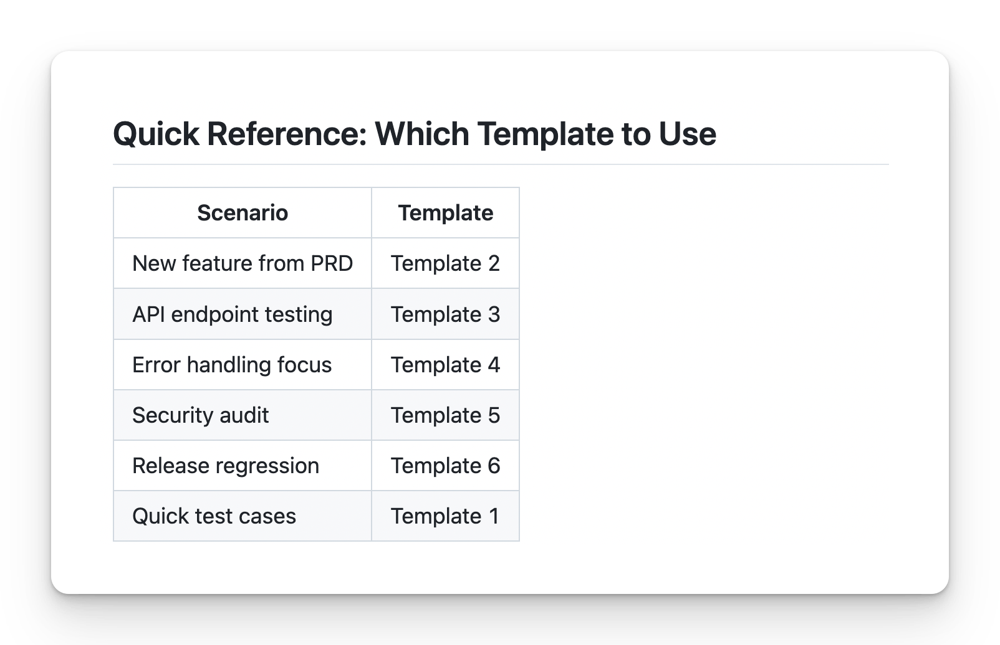
</p>
<p align="center"><em>The quick-reference card shipped beside the six test-case templates: pick a template by scenario instead of by guesswork.</em></p>

### Generated deliverables in `output/`

- **Adactin Hotel App login** — functional test plan from the STAR prompt (`Adactin_HotelApp_Login_Functional_Test_Plan.docx`), with the prompt itself kept alongside as `Adactin_HotelApp_Login_Test_Plan_Prompt.{html,pdf}`.
- **VWO login** — functional test plan from STAR (`VWO_Login_Functional_Test_Plan.docx`), 10 functional test cases from CLEAR (`VWO_Login_CLEAR_Functional_Test_Cases.docx`), and a hypothetical bug report from CRISP (`VWO_Login_CRISP_Bug_Report.docx`).

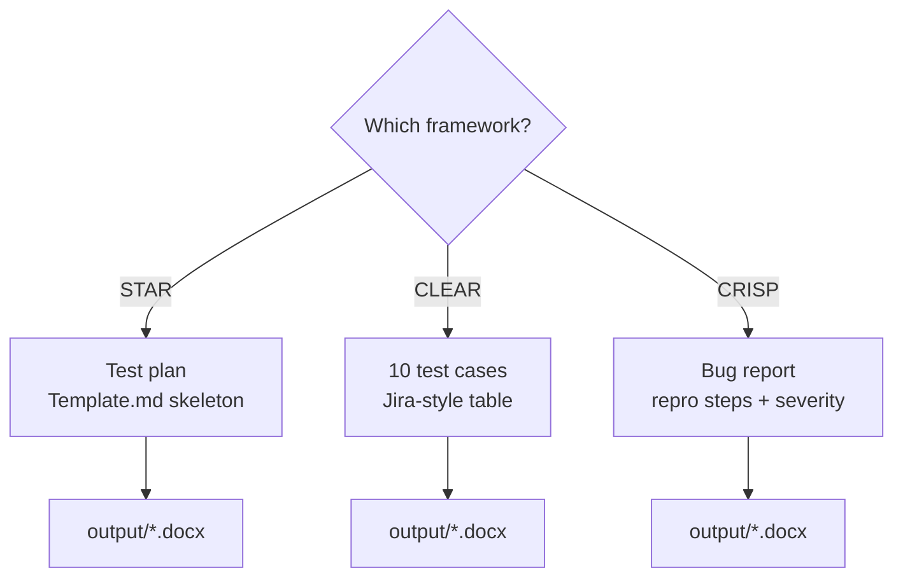

All three prompts share the same guardrail the skills use: only the supplied requirements, no invented error text or password policy, placeholders instead of real credentials, and unspecified behaviour marked *"Requires clarification"*.

### Daily QA template library — `Task14Nov2026_QA_DailyTask/`

Seventeen standalone prompt templates, one per task a QA engineer repeats, each committed to a single framework so there is exactly one output contract to validate against. `INDEX.md` holds the task → framework → file map.

| Framework | Files | Tasks |
|-----------|-------|-------|
| **RICE-POT** | 5 | Requirement analysis · test case design · RTM · gap analysis · automation code generation |
| **CRISP** | 5 | Bug report · defect tracking · bug triaging · code review · PR merge review |
| **CLEAR** | 4 | Test case execution · smoke & sanity · UI/API testing · test coverage |
| **STAR** | 3 | Regression testing · daily scrum notes · status report |

Every template carries the same six parts: framework skeleton with QA placeholders, a filled mini-example, an explicit output contract (fixed sections and columns), a self-check list, ready `SKILL.md` frontmatter with trigger phrases, and a single `Alternative:` pointer to a better-fitting template — a pointer, not a second skeleton, so the model cannot blend two output shapes.

Shared non-negotiables across the library: deterministic output, no invented facts, missing detail written as *"Insufficient information to determine."*, deductions labelled *"Inference (low confidence)"*, gap IDs in the form `GAP-NN`, credentials as placeholders only, and nothing marked Passed without observable evidence.

#### HTML usage guides

Each template has a browsing guide beside it — `NN-<task>-<FRAMEWORK>-usage-guide.html` — seventeen self-contained files that open directly in a browser with no build step. Each guide covers:

- what the template does, and when to use or skip it;
- the framework letter map, and which block is the only one you edit per run (Context for RICE-POT/CLEAR, Situation for STAR);
- an input checklist plus a placeholder worksheet for that block;
- the output contract to audit the response against;
- a filled example taken from the template's own case;
- the self-check, followed by a symptom → rule breached → correction table for repairing a bad run;
- the three templates the output feeds into next, and the `SKILL.md` conversion.

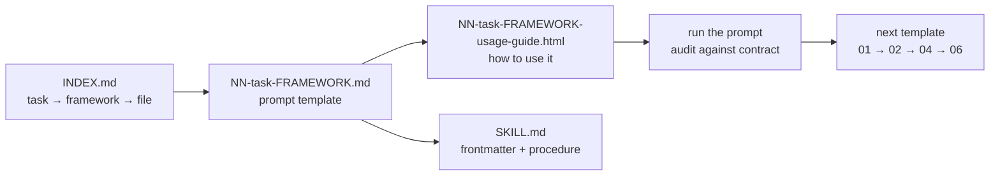

## Chapter 04 — AI Agents Basics

`Chapter_04_AI_Agents_Basics/VIBE_CODING/` builds QA agents the vibe-coding way: a design, a RICE-POT prompt plan, then a working implementation, with each agent in its own numbered folder. All three agents are live on Vercel.

| Step | Folder | What it holds |
|------|--------|---------------|
| Design | `00_design/` | Screen design mockup for that agent |
| Plan | `01_plan/` | `RICEPOT_Framework.md` plus the output template the agent must fill |
| Build | `02_implementation/src/` | Build prompt (`prompt_*_Creator.md`), the app, `vercel.json` and a README |

| Agent | Jira in → document out | Template | Live |
|-------|------------------------|----------|------|
| `01_Intelligent_Test_Planning_AIAgent` | ticket → **test plan** | 8 sections + Human Review Gate | [ai5x-intelligenttestplan](https://ai5x-intelligenttestplan.vercel.app) |
| `02_Test_Strategy_Builder_AIAgent` | ticket → **test strategy** | 14 sections + Human Review Gate | [ai5x-teststrategybuilder](https://ai5x-teststrategybuilder.vercel.app) |
| `03_Test_Case_Creation_AIAgent` | ticket → **test cases** | Scope & Traceability, Preconditions, Test Data, TC-n blocks, Coverage Matrix, Automation Candidates + Human Review Gate | [ai5x-testcasecreator](https://ai5x-testcasecreator.vercel.app) |

Every agent follows the same pattern: a Main page with the reply panel and a Jira-key input, and a Settings panel with **Test Connection** for Jira plus **Test Local LLM** / **Test Groq.com**. Credentials stay server-side — `GET /api/config` and `GET /api/settings` return booleans only.

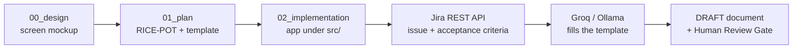

### `01_Intelligent_Test_Planning_AIAgent`

Turns a Jira issue ID into a test plan in the supplied template — eight sections, ending with the mandatory **Human Review Gate**.

- **Frontend** — React 18 + Vite: reply panel, prompt input, and a Settings panel with **Test Connection**, **Test Local LLM** and **Test Groq.com** checks.
- **Backend** — Express: reads `VIBE_CODING/.env`, fetches the issue over the Jira Cloud REST API v3 (flattening Atlassian Document Format to text) and asks an LLM to fill the template.
- **LLM providers** — Groq (default `openai/gpt-oss-120b`) or a local Ollama (`llama3.2:1b`).
- **Endpoints** — `GET /api/config`, `POST /api/jira/test`, `POST /api/llm/test`, `POST /api/testplan`.
- **Deployed** — with Express exported as a single Vercel Function through `api/index.js`.

Its README records the verification runs (`SAM1-8`), the mapped API errors (400 invalid ID, 404 not found or not visible) and the known limits: Jira Cloud only, Markdown rendered as preformatted text, Ollama local-only in production, and no authentication on the deployment.

<p align="center">
  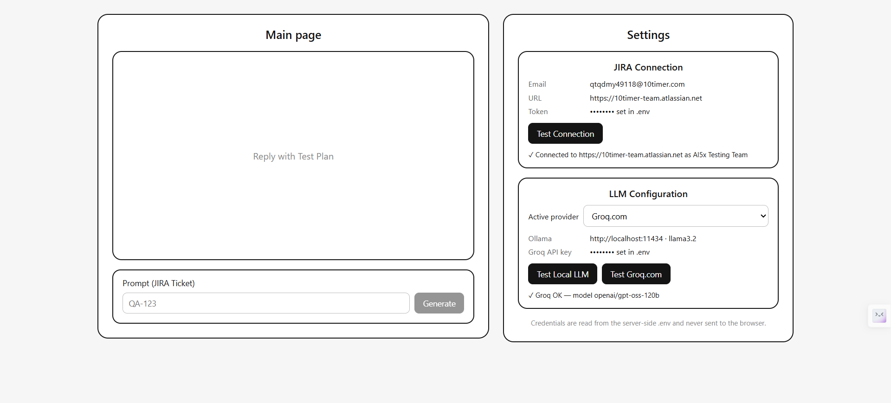
</p>
<p align="center"><em>Main page with the Jira-key prompt, and Settings showing the Jira and Groq checks passing.</em></p>

<p align="center">
  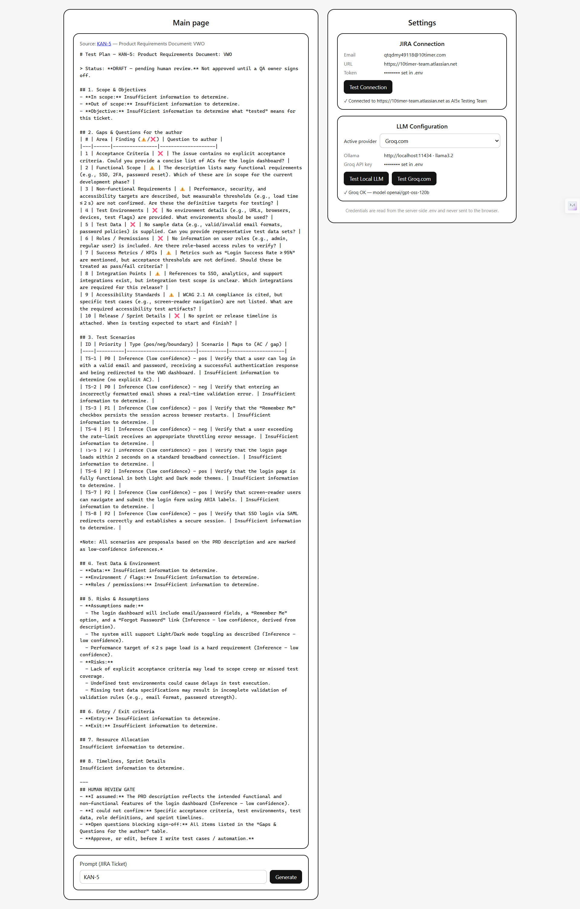
</p>
<p align="center"><em>A generated <code>KAN-5</code> plan: gaps table, P0/P1 scenarios and the closed Human Review Gate. Also saved as <code>test-plan.md</code>.</em></p>

### `02_Test_Strategy_Builder_AIAgent`

Turns a Jira issue ID into a **14-section test strategy** (overview, scope, quality risks, test approach, levels, data & environments, automation, non-functional, resources, timeline, entry/exit, assumptions, risks & mitigations, deliverables) from `01_plan/test-strategy-template.md`, then closes with the **Human Review Gate**.

- **Stack** — Express serving a vanilla HTML/CSS/JS frontend from `public/`, no build step.
- **Settings** — Jira URL/email/token and Groq key, with **Test Connection** and **Test LLM**; on Vercel these come from environment variables instead of a writable `.env`.
- **Endpoints** — `POST /api/generate`, `GET`/`POST /api/settings`, `POST /api/settings/test-jira`, `POST /api/settings/test-llm`.
- **Deployed** — `api/index.js` re-exports the app; `includeFiles` bundles the template into the function.

The learning entry records the fixes that made this work: `llama-3.3-70b-versatile` was returning 404 so the app moved to `openai/gpt-oss-120b`, and `max_completion_tokens: 8000` with `reasoning_effort: 'low'` was needed to stop the document truncating at section 13.

<p align="center">
  
</p>
<p align="center"><em>Generated <code>KAN-5</code> strategy with the Copy / Download .md actions. Also saved as <code>test-strategy.md</code>.</em></p>

<p align="center">
  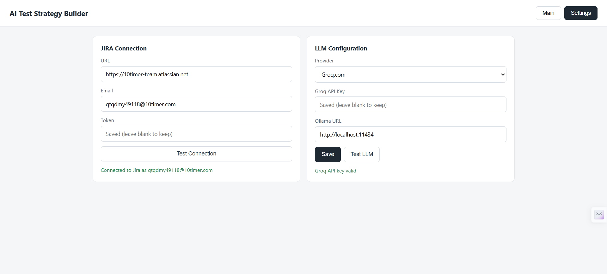
</p>
<p align="center"><em>Settings tab: Jira connection and Groq API key both verified.</em></p>

### `03_Test_Case_Creation_AIAgent`

Turns a Jira issue ID into an **execution-ready test-case document** from `01_plan/test-case-template.md`: Scope & Traceability, Preconditions, Test Data, per-case `TC-n` blocks with step tables, Coverage Matrix, Automation Candidates, Assumptions & Dependencies, and Execution Notes.

- **Stack** — Express + vanilla HTML/CSS/JS, Jira REST API v3, Groq (or Ollama).
- **Endpoints** — `POST /api/generate`, `GET`/`POST /api/settings`, `POST /api/settings/test-jira`, `POST /api/settings/test-llm`.
- **Deployed** — same serverless layout; the template is bundled via `includeFiles`.

Notable fixes: Jira Cloud returns descriptions and acceptance criteria as nested ADF JSON, so an `adfToText` converter flattens them; and the legacy `/rest/api/3/search` endpoint is retired, so issues are discovered through `/rest/api/3/search/jql` with a bounded JQL. Verified end-to-end against `KAN-4` (~12.6 KB of Markdown following the template).

<p align="center">
  
</p>
<p align="center"><em>Generated <code>KAN-4</code> test cases with full AC traceability. Also saved as <code>test-cases.md</code>.</em></p>

## Chapter 05 — AI Agents with n8n

`Chapter_05_AIAgents_n8n/` carries four chat-triggered n8n agents as importable JSON, plus a one-page primer. They mirror the three Chapter 04 vibe-coded agents — same prompts, same templates — but run entirely inside n8n with the Jira tool attached to the agent.

| Workflow | Chain | What it does |
|----------|-------|--------------|
| `01_QA_Assistant.json` | Chat trigger → AI agent → Groq chat model | Answers QA questions only; off-topic prompts get a fixed refusal pointing at smoke testing, sanity, automation, Selenium and Playwright. |
| `02_Jira_TestPlan.json` | Chat trigger → AI agent → Groq chat model + Jira tool | Takes a Jira key (e.g. `VWO-140`), reads the issue through the Jira tool, and returns the eight-section test plan marked **DRAFT — Pending Human Review**. |
| `03_AI-Powered_Jira_Test_Strategy_Agent.json` | Chat trigger → AI agent → Groq chat model + Jira tool | Returns the **14-section** test strategy in Markdown, using *Not Provided* / *Requires Clarification* for gaps and closing with the Human Review Gate. |
| `04_Test_Case_Creation_AI_Agent.json` | Chat trigger → AI agent → Groq chat model + Jira tool | Returns execution-ready test cases in one consolidated table with TC IDs, AC traceability, an RTM and test-case statistics. |

`MyNotes.md` holds every system prompt — the QA-only guardrail plus the full RICE-POT prompts for test plan, test strategy and test cases — along with the published chat URLs. Each workflow ships with a sticky note and retry settings (4 tries, 15 s apart) so a rate-limited Groq call does not fail the run.

Import a workflow into n8n, attach your own Groq and Jira credentials, then open its chat URL.

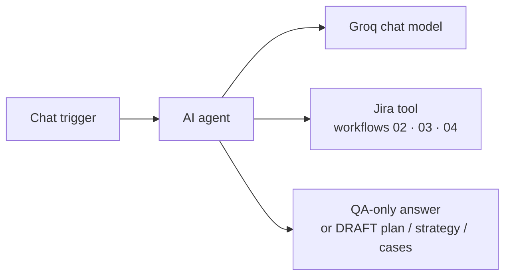

<p align="center">
  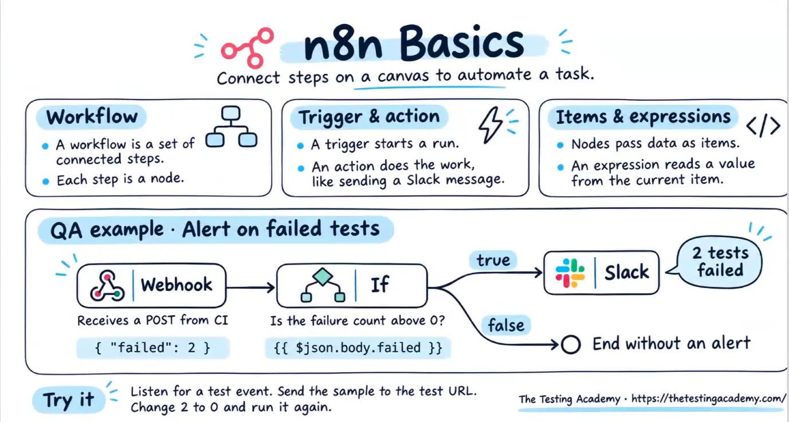
</p>
<p align="center"><em><code>n8n_Basics.png</code> — the one-page primer: workflow, trigger vs. action, items and expressions, and a QA example that alerts Slack when tests fail.</em></p>

## Standalone Playwright Login Test

`Playwright_Simple_Login/` is a minimal, self-contained Playwright + TypeScript project — deliberately independent of the generated frameworks — so the login flow can be run on its own:

- **`tests/login.spec.ts`** — two tests against the public demo app `https://the-internet.herokuapp.com/login`: valid credentials reach `/secure`, invalid credentials stay on `/login` with the error flash.
- **`playwright.config.ts`** — Chromium only, single worker, no retries, `list` + HTML reporters, trace retained and screenshot captured on failure.
- Locators are role/label based with web-first assertions, matching the conventions used in `PlaywrightFramework/`.

Run it with `npm install`, then `npm test` (or `npm run test:headed`). Use `npm run typecheck` for a `tsc --noEmit` pass.

## Learning Journal

`learnings/` holds one dated Markdown file per completed task, written in the format defined by `AGENTS.md` (objective, tools, steps, code, challenges, learnings, verification). It is the running record of what was generated, how, and what broke along the way — recent entries cover the KAN-4 Jira test plan, the standalone Playwright login test, the VWO test cases and GAP-01 resolution, the RICE-POT anti-hallucination pass, the STAR / CLEAR / CRISP DOCX deliverables, the 17-task daily QA template library, the HTML usage guides generated for those templates, the live-verified Adactin hotel-app context pack, the three vibe-coded Chapter 04 agents (test plan, test strategy, test cases) with each Vercel deployment, and the four n8n agents.

## Core Principles

The content-generating skills and prompts follow the same rules:

1. Use only information provided by the user (or fetched from the linked ticket).
2. Do not invent requirements beyond what is given.
3. Never mark a plan "final" — a human owns sign-off.

Both also enforce a safety rule: generated output must not contain personal information or anything risky.

## Configuration

The advanced `testplan-creator-skill_a` skill fetches tickets from Jira and reads credentials from `Chapter_00_SKILL_Basics/.env`:

```
JIRA_BASE_URL=https://<your-org>.atlassian.net
JIRA_EMAIL=<your-email>
JIRA_API_TOKEN=<your-api-token>
```

> **Security:** `.env` holds a live API token. Do not commit it — add it to `.gitignore` and rotate the token if it has ever been exposed.

The Adactin context pack keeps a separate `Chapter_03_Prompt_Engineering_QA/00_context-hotelapp/.env` with the test account used to verify Build 2. The root `.gitignore` already excludes every `.env`, so it is never committed, and no credentials appear in the context files or learning entry.

All three Chapter 04 agents read the same `Chapter_04_AI_Agents_Basics/VIBE_CODING/.env`:

```
JIRA_BASE_URL=https://<your-org>.atlassian.net
JIRA_EMAIL=<your-email>
JIRA_API_TOKEN=<your-api-token>
GROQ_API_KEY=<key>

# Optional
GROQ_MODEL=
OLLAMA_URL=http://localhost:11434
OLLAMA_MODEL=llama3.2
```

On Vercel the four required values are stored as project environment variables instead of a deployed `.env` — each agent is its own Vercel project (`ai5x-intelligenttestplan`, `ai5x-teststrategybuilder`, `ai5x-testcasecreator`) with the same four secrets. The Chapter 05 n8n agents keep their Groq and Jira credentials inside n8n, not in the repository.

The Chapter 00 and Chapter 02/03 prompt workflows otherwise need no credentials. The DOCX deliverables are generated with `python-docx` (see `learnings/` for the exact toolchain per task).

## Usage

**Skills (Chapter 00)** — open the repository in Command Code, then:

1. Choose a trigger:
   - **PRD-driven** (basic skills): provide a PRD or a phrase such as *"create a test plan for X"* / *"create a test case for X"*.
   - **Jira-driven** (advanced skill): provide a Jira key such as *"create a test plan for KAN-4"*.
2. The matching skill generates the deliverable and writes it to `Chapter_00_SKILL_Basics/output/`.

**Prompt frameworks (Chapter 02/03)** — reference the prompt file and state the output format, e.g.

```
@Chapter_03_Prompt_Engineering_QA/CLEAR.md use this prompt and give me the
output in docx in the Chapter_03_Prompt_Engineering_QA/output folder
```

Swap in `STAR.md`, `STAR_HotelApp.md`, or `CRISP.md` for a test plan or bug report. The run log lives in `Chapter_03_Prompt_Engineering_QA/MyNotes.md`.

**Daily QA templates (Chapter 03)** — pick the task from `Task14Nov2026_QA_DailyTask/INDEX.md`, open the guide next to it, then reference the template:

```
@Chapter_03_Prompt_Engineering_QA/Task14Nov2026_QA_DailyTask/01-requirement-analysis-RICEPOT.md
analyse these requirements and return the requirement register and gap register
```

The matching `-usage-guide.html` opens in a browser and walks through the placeholder worksheet, the output contract to audit against, and the self-check; each template also ends with the `SKILL.md` frontmatter needed to convert it into a reusable skill.

**Generated frameworks (Chapter 02)** — the Selenium and Playwright projects are standalone; open the relevant folder and follow its own README/pom or `npm` scripts.

**Jira agents (Chapter 04)** — fill `Chapter_04_AI_Agents_Basics/VIBE_CODING/.env` (see Configuration), then start whichever agent you want:

```bash
# Jira test plan — React + Vite frontend, Express API
cd Chapter_04_AI_Agents_Basics/VIBE_CODING/01_Intelligent_Test_Planning_AIAgent/02_Implementation/src
npm install && npm run dev        # UI http://localhost:5173 · API http://localhost:3001

# Jira test strategy — Express serves the frontend
cd Chapter_04_AI_Agents_Basics/VIBE_CODING/02_Test_Strategy_Builder_AIAgent/02_implementation/src
npm install && npm start          # http://localhost:3000

# Jira test cases — Express serves the frontend
cd Chapter_04_AI_Agents_Basics/VIBE_CODING/03_Test_Case_Creation_AIAgent/02_implementation/src
npm install && npm start          # http://localhost:3000
```

In each app: open **Settings** and confirm the Jira and Groq checks pass, then enter a Jira issue ID and press Generate. The generated Markdown can be copied or downloaded as `.md`.

**n8n agents (Chapter 05)** — import any of `01_QA_Assistant.json`, `02_Jira_TestPlan.json`, `03_AI-Powered_Jira_Test_Strategy_Agent.json` or `04_Test_Case_Creation_AI_Agent.json` into n8n, attach your own Groq and Jira credentials, then open the published chat URL.

> **`AGENTS.md`** at the repository root instructs the agent to log every completed task as a dated Markdown file in `learnings/` — see that folder for examples.

## Author

Sathish Kumar A S — The Testing Academy

## License

MIT
