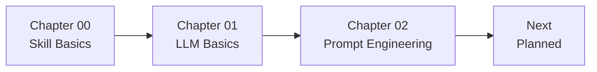
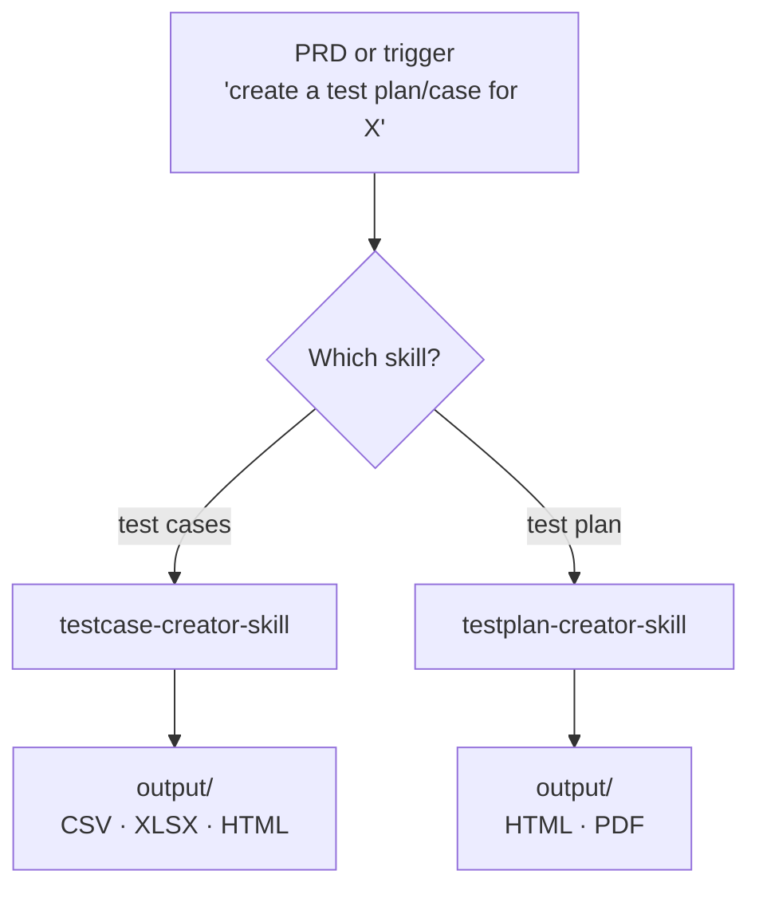
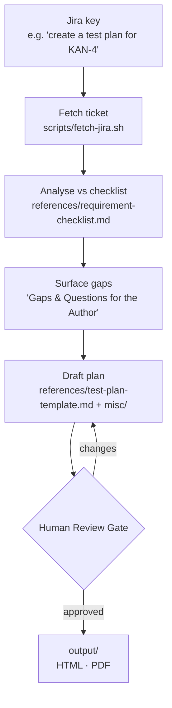
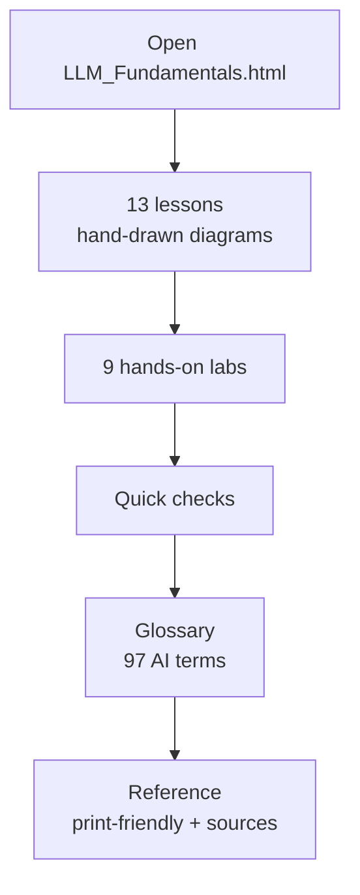
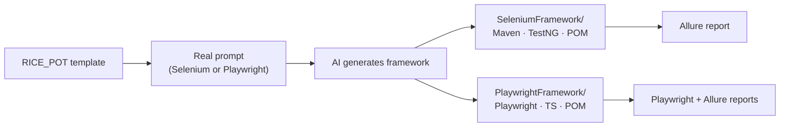

# AI Tester Blueprint 5x

A hands-on learning repository for building AI-assisted QA workflows with Command Code. It walks from authoring reusable skills, through LLM fundamentals, to prompt engineering — and ships ready-made artifacts (test plans, test cases) generated by those skills.

## Roadmap

The repository is a staged path: **author skills → understand the models → engineer the prompts**.



| Stage | Chapter | Focus | Status |
|-------|---------|-------|--------|
| 1 | Chapter 00 — Skill Basics | Author and run reusable Command Code skills that generate test plans / test cases | ✅ Done |
| 2 | Chapter 01 — LLM Basics | LLM fundamentals self-study guide (lessons, labs, glossary) | ✅ Done |
| 3 | Chapter 02 — Prompt Engineering | RICE_POT prompt framework → generated Selenium / Playwright frameworks | ✅ Done |
| 4 | Next | API-response-validator skill, more advanced skills, CI wiring | 🔜 Planned |

## Repository Structure

```
AITesterBlueprint5x/
├── Chapter_00_SKILL_Basics/            # Authoring and using Command Code skills
│   ├── 00_Basic_Skills/                # PRD-driven skills
│   │   ├── api-response-validator-skill/   # Placeholder (SKILL.md pending)
│   │   ├── testcase-creator-skill/         # Generates test cases from a PRD
│   │   └── testplan-creator-skill/         # Generates a test plan from a PRD
│   ├── 01_Advanced_Skills/
│   │   └── testplan-creator-skill_a/   # Jira-driven test plan (fetch → gap analysis → review gate)
│   │       ├── references/             # Gap-analysis checklist + plan template
│   │       ├── scripts/                # fetch-jira.{sh,py} — pull a ticket over the Jira REST API
│   │       ├── misc/                   # Company details + logo (mycompanydetails.md, company.png)
│   │       └── assets/                 # Skill assets (currently empty)
│   ├── output/                         # Generated deliverables (HTML, PDF, XLSX, CSV)
│   │   ├── KAN-4_Passkey_SSO_Login_Test_Plan.{html,pdf}
│   │   ├── VWO_Login_Dashboard_Test_Plan.{html,pdf}
│   │   └── VWO_Login_Dashboard_Test_Cases.{html,xlsx,csv}
│   ├── resources/                      # Source / reference material (e.g. VWO-49.doc)
│   ├── .env                            # Jira credentials for the advanced skill (see Configuration)
│   └── MyNotes.md                      # Working notes and context for generated plans
├── Chapter_01_LLM_Basics/              # LLM fundamentals self-study guide
│   └── LLM_Fundamentals.html           # Interactive guide: lessons, labs, glossary
└── Chapter_02_Prompt_Engineering/      # Prompt engineering with the RICE_POT framework
    └── RICE_POT/
        ├── Template_RICE_POT/          # Blank RICE-POT prompt template
        ├── REALPROMPT_RICE_POT.md      # Filled prompt → Selenium + Java (Salesforce login)
        ├── REALPROMPT_RICE_POT_PW.md   # Filled prompt → Playwright + TypeScript (VWO login)
        ├── SeleniumFramework/          # Generated Maven / TestNG framework + Allure report
        └── PlaywrightFramework/        # Generated Playwright / TypeScript framework + Allure report
```

## Skills

Skills are reusable instruction modules that Command Code loads on demand. Each one lives in its own folder with a `SKILL.md` file that declares frontmatter (`name`, `description`, `version`, `author`, `license`, `tags`) followed by the instructions the agent follows.

### Basic skills — `Chapter_00_SKILL_Basics/00_Basic_Skills/`



#### `testcase-creator-skill`

Creates test cases from a PRD or a direct trigger such as *"create a test case for X"*, using the VWO.com template.

Output columns: `Scenario_TID`, `TestCase Description`, `PreCondition`, `TestSteps`, `Expected Result`, `Actual Result`, `Steps to Execute`, `Expected Result`, `Actual Result`, `Status`, `Executed QA Name`, `Misc (Comments)`, `Priority`, `Is_Automated`.

Deliverables: CSV, XLSX, and HTML.

#### `testplan-creator-skill`

Creates a full test plan from a PRD using the VWO.com template, covering objective, scope, inclusions, environments, defect reporting, strategy, schedule, deliverables, entry/exit criteria, tools, risks, and approvals.

Deliverables: HTML and PDF.

#### `api-response-validator-skill`

Reserved for validating API responses. The `SKILL.md` is currently a placeholder.

### Advanced skill — `Chapter_00_SKILL_Basics/01_Advanced_Skills/testplan-creator-skill_a/`

#### `advance-testplan-creator`

Turns a **JIRA ticket** into a review-ready test plan. It is a stricter, Jira-driven evolution of the basic test-plan skill and follows a fixed workflow:

1. **Fetch the ticket** — pulls the issue over the Jira REST API (`scripts/fetch-jira.sh`) and captures summary, description, acceptance criteria, components, links, and fix version.
2. **Analyse against a checklist** — scores the ticket against `references/requirement-checklist.md`, marking each item ✅ present / ⚠️ ambiguous / ❌ missing.
3. **Surface the gaps** — produces a *"Gaps & Questions for the Author"* section (the highest-value output).
4. **Draft the plan** — fills `references/test-plan-template.md`, driving scenarios from the acceptance criteria and gaps; tags each scenario P0/P1/P2; adds company info and logo from `misc/`.
5. **Stop for human review** — ends with a mandatory **Human Review Gate** and never marks the plan as final.



Deliverables: HTML and PDF.

## Generated Artifacts

Example deliverables produced by the skills are stored in `Chapter_00_SKILL_Basics/output/`:

- **KAN-4** — VWO Passkey & SSO login test plan (HTML + PDF), generated by the advanced skill.
- **VWO Login Dashboard** — test plan (HTML + PDF) and test cases (HTML, XLSX, CSV).

The PDF is produced from the finished HTML so the two match 1:1.

## Chapter 01 — LLM Basics

`Chapter_01_LLM_Basics/LLM_Fundamentals.html` is a self-contained, interactive study guide covering LLM fundamentals from scratch, aimed at QA testers new to AI:

- **13 short lessons** with hand-drawn diagrams — tokens, embeddings, context windows, sampling, prompting, and more.
- **9 hands-on labs** — tokenizers, probability bars, context budgeting, and other runnable demos that work entirely in the browser.
- **Quick checks** — collapsible checkpoint questions to test understanding.
- **Glossary** — 97 AI terms, searchable and filterable.
- **Reference** — print-friendly layout and a curated source list.

Open the file directly in any browser — no build step or server required.



## Chapter 02 — Prompt Engineering

`Chapter_02_Prompt_Engineering/RICE_POT/` applies the **RICE_POT** prompt framework (Role · Instructions · Context · Example · Parameters · Output · Tone) to generate automation frameworks:

- **`Template_RICE_POT/Template.RICEPPOT.md`** — a blank RICE-POT prompt template.
- **`REALPROMPT_RICE_POT.md`** — a filled prompt that generates a **Selenium + Java** (Maven/TestNG) framework for the Salesforce login page.
- **`REALPROMPT_RICE_POT_PW.md`** — a filled prompt that generates a **Playwright + TypeScript** framework for the VWO login page.
- **`SeleniumFramework/`** — the generated Maven project (`pom.xml`, `testng.xml`, Page Object + valid/invalid tests) with an Allure report.
- **`PlaywrightFramework/`** — the generated Playwright/TypeScript project (`pages/`, `tests/`, `fixtures/`, `utils/`, `playwright.config.ts`) with Playwright + Allure reports.



## Core Principles

The content-generating skills follow the same rules:

1. Use only information provided by the user (or fetched from the linked ticket).
2. Do not invent requirements beyond what is given.
3. Never mark a plan "final" — a human owns sign-off.

Each skill also enforces a safety rule: generated output must not contain personal information or anything risky.

## Configuration

The advanced `testplan-creator-skill_a` skill fetches tickets from Jira and reads credentials from `Chapter_00_SKILL_Basics/.env`:

```
JIRA_BASE_URL=https://<your-org>.atlassian.net
JIRA_EMAIL=<your-email>
JIRA_API_TOKEN=<your-api-token>
```

> **Security:** `.env` holds a live API token. Do not commit it — add it to `.gitignore` and rotate the token if it has ever been exposed.

## Usage

1. Open the repository in Command Code.
2. Choose a trigger:
   - **PRD-driven** (basic skills): provide a PRD or a phrase such as *"create a test plan for X"* / *"create a test case for X"*.
   - **Jira-driven** (advanced skill): provide a Jira key such as *"create a test plan for KAN-4"*.
3. The matching skill generates the deliverable and writes it to `Chapter_00_SKILL_Basics/output/`.

## Author

Sathish Kumar A S — The Testing Academy

## License

MIT
