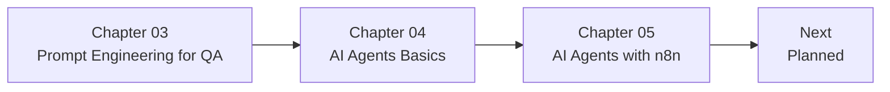

# README Sync for Chapters 04 and 05

## Date

2026-11-15

## Objective

Bring `README.md` back in line with the repository after two new untracked chapters were added:

- `Chapter_04_AI_Agents_Basics/` — the VIBE_CODING path with the implemented `01_Intelligent_Test_Planning_AIAgent` (React + Express Jira test-plan generator) and two placeholder agent folders.
- `Chapter_05_AIAgents_n8n/` — two importable n8n chat-agent workflows, an n8n primer image, and prompt/URL notes.

## Tools and Technologies Used

- Command Code (agent runtime)
- `git status`, `git diff`, `git ls-files`-style filtering of untracked output for repository state
- `read_file`, `glob`, `read_directory` for source inspection
- `findstr` to inspect workflow node types and confirm README headings after editing
- Markdown editing

## Steps Performed

1. Read `README.md` and ran `git status --short` / `git diff` to see what the README already covered (Chapters 00–03) and what was missing.
2. Enumerated the new chapter trees. Excluded ignored build output (`node_modules`, `.vercel`, `.env`) and identified the files that are actually part of the repository.
3. Read `Chapter_04_AI_Agents_Basics/VIBE_CODING/01_Intelligent_Test_Planning_AIAgent/02_Implementation/README.md`, `MyNotes.md`, `prompt_TP_Creator.md`, `package.json`, the plan files, and the Vercel deployment learning entry to describe the agent accurately.
4. Inspected both Chapter 05 workflow JSONs for their node chains (chat trigger, LangChain agent, Groq chat model, Jira tool) and read `MyNotes.md` for the system prompts.
5. Viewed `n8n_Basics.png` to describe the primer and its QA alert example correctly.
6. Updated the README: intro, roadmap diagram, roadmap table, repository tree, two new chapter sections, Configuration, Usage, and the Learning Journal paragraph.
7. Verified the edited regions and chapter headings by reading them back and searching with `findstr`.

## Code Examples

Repository tree entries added:

```text
├── Chapter_04_AI_Agents_Basics/        # Vibe-coded QA AI agents (design → plan → implementation)
│   └── VIBE_CODING/
│       ├── .env                        # Jira + Groq credentials (gitignored)
│       ├── 01_Intelligent_Test_Planning_AIAgent/
│       │   ├── 00_design/              # Screen design plan (screen_design_plan.png)
│       │   ├── 01_plan/                # RICE-POT framework + test-plan template
│       │   ├── 02_Implementation/      # Build prompt, React + Express app, Vercel config, README
│       │   └── MyNotes.md              # Build prompt log for the agent
│       ├── 02_Test_Strategy_Builder_AIAgent/   # Placeholder (planned)
│       └── 03_Test_Case_Creation_AIAgent/      # Placeholder (planned)
├── Chapter_05_AIAgents_n8n/            # n8n AI-agent workflows (importable JSON)
│   ├── 01_QA_Assistant.json            # Chat trigger → AI agent → Groq, QA-only answers
│   ├── 02_Jira_TestPlan.json           # Chat trigger → AI agent + Jira tool + Groq, RICE-POT plans
│   ├── n8n_Basics.png                  # One-page n8n primer + QA alert example
│   └── MyNotes.md                      # System prompts and published chat URLs
```

New roadmap edges:



## Challenges Faced

- Both chapters are untracked, so `git status` listed thousands of files from `node_modules` and `.vercel`. The tree had to reflect only files that belong in the repository.
- The `grep` tool returned no matches for some JSON/Markdown content that `read_file` displayed, so `findstr` was used as a fallback to inspect workflow node types and confirm headings.
- `Chapter_05_AIAgents_n8n/MyNotes.md` stores a throwaway mailbox login and published chat URLs in plaintext. The README references the notes only generically; the credentials were not copied into the README or this entry.

## Solutions Implemented

- Filtered `git status --untracked-files=all` to exclude `node_modules` and `.vercel`, confirming the exact set of source files to document.
- Documented the implemented Chapter 04 agent end to end: design → plan → build, stack, endpoints, live URL, verification runs, and known limits.
- Documented Chapter 05 as two importable workflows with their distinct chains, plus the primer and notes.
- Added the Chapter 04 environment variables to Configuration and noted that Vercel and n8n hold credentials outside the repo.
- Added run/import instructions to Usage and refreshed the intro, roadmap, and Learning Journal.

## Key Learnings

- Documenting an untracked chapter needs a filtered file inventory; otherwise generated `node_modules`/`.vercel` output distorts the repository tree.
- The two n8n workflows differ meaningfully: `01_QA_Assistant` is a QA-scoped chat agent, while `02_Jira_TestPlan` adds a Jira tool and a RICE-POT output contract.
- The Chapter 04 agent is verified against `SAM1-8` in both local and deployed environments, but it has no deployment authentication — worth stating explicitly in the README.

## Testing and Verification

- `findstr` confirmed all chapter headings, the Chapter 04/05 roadmap rows, the Configuration section, and the Usage entries are present.
- Re-read every edited README region to confirm tables, code fences, and Mermaid blocks are intact.
- No application tests were run; this was a documentation-only change. The Chapter 04 verification results quoted in the README come from its own `README.md`.

## Future Improvements

- Add Chapter 04 sections for `02_Test_Strategy_Builder_AIAgent` and `03_Test_Case_Creation_AIAgent` once they are implemented.
- Add a learning entry for the Chapter 05 n8n workflows once they are treated as completed work.
- Consider redacting the plaintext mailbox credentials and chat URLs from `Chapter_05_AIAgents_n8n/MyNotes.md`, or moving them to a gitignored file.
